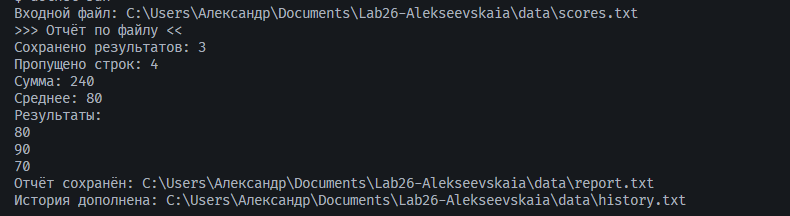

# Практическая работа №26

Автор: Алексеевская Елена

Группа: ИСП-251

## Тема

Работа с текстовыми файлами в C#.

## Что реализовано

- пути к файлам через Path.Combine;
- чтение результатов из файла в UTF-8;
- проверка строк через TryParse;
- формирование и сохранение отчёта;
- добавление записи в историю запусков;
- обработка ошибок файловых операций.

## Короткие ответы

1. От какой папки отсчитывается относительный путь?

Ответ: От текущей рабочей папки.

2. Чем отличаются WriteAllText и AppendAllText?

Ответ: WriteAllText перезаписывает файл целиком, а AppendAllText дописывает в конец, сохраняя старое содержимое (и создает файл сам, если там его нет)

3. Чем ошибка чтения файла отличается от некорректной строки внутри файла?

Ответ: Ошибка чтения - сбой файловой операции, его не удается открыть,  ловится через try/catch. Некорректная строка - файл прочитан успешно, но значение не число или вне диапазона; это ошибка и не исключение, так как такие строки пропускают через TryParse.

## Файлы программы

- data/scores.txt — входные результаты;
- data/report.txt — последний отчёт;
- data/history.txt — история запусков.
Запускать dotnet run из папки проекта.

## Результат

